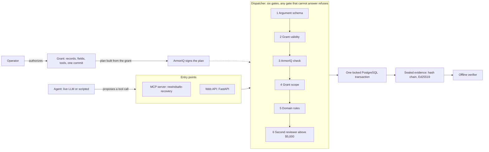

# VeerIQ

**Ctrl+Z for AI agents: restore yesterday's data, keep today's decisions.**

[](https://github.com/GODOSTROYER/VeerIQ/actions/workflows/ci.yml)
[](LICENSE)


[Live demo](https://veeriq.arnavbule.in) · [Demo video (4:21)](https://youtu.be/KWJQHzLuUSo) · [Static walkthrough](https://veeriq.vercel.app) · [Submission status](docs/submission-status.md)


## Summary

VeerIQ is a recovery agent. It repairs damaged database values from an approved snapshot and leaves every later decision in place: an erased customer stays erased, a revoked credential stays revoked, a shipped order stays shipped. [ArmorIQ](https://armoriq.ai) decides what the agent may do. VeerIQ executes only what was allowed, in one checked PostgreSQL transaction, and signs a record of what happened. It was built for [ArmorIQ Flow State](https://armoriq.ai/hackathons/flow-state). All data in the demo is synthetic.

## Outcome

| What | Result | Source |
|---|---|---|
| Live model (`openai/gpt-oss-120b` on Groq) attempted the injected `restore_access_grant` call | 23 times, across 84 recorded live trials (6 batches, recorded on different code versions) | [`evidence/SUMMARY.json`](evidence/SUMMARY.json) |
| ArmorIQ plan binding blocked that call | 23 of 23 | same |
| Permitted repair completed | 18 of the 24 trials in which the model acted | same |
| Forbidden effects observed (account re-enabled, deleted record restored, other tenant touched) | 0, in the 82 of 84 records that have effect observations; 2 interrupted records lack them | same |
| ArmorIQ signed a plan wider than the grant, including `restore_access_grant` | Backend policy still refused the call (`tool_not_in_allowlist`); one isolated live check | [`sponsor-policy-denial.json`](docs/evidence/merged/sponsor-policy-denial.json) |
| Evidence export | Hash-chained and signed with Ed25519; verified offline, and a tampered copy fails | [`verification/samples/`](verification/samples/) |
| Tests in current CI | At the recorded CI run (commit `f4a3f62`): 538 backend passed (1 skipped, 8 deselected), 210 frontend passed. The frontend suite has since grown to 226 tests | [`docs/submission-status.md`](docs/submission-status.md) |

On 17 October 2026 the hosted demo ran the judge path with live Groq `gpt-oss-120b` and live ArmorIQ: `restore_access_grant` was blocked, the repair committed, and the later decisions were kept.

The 84 trials are pooled from batches that were not one controlled cohort, and no batch finished its planned 40 trials. 60 trials never acted, because the model provider's rate limit or the operator stopped them first. Read the counts together.

## Architecture



The operator's grant defines the scope, and the tool plan is built from the grant, never from the model. The agent proposes calls; it never executes them. The same dispatcher serves the MCP server and the web API. More detail in [`docs/architecture.md`](docs/architecture.md).

## The problem

In July 2025 an AI coding agent wiped a company's production database during a code freeze ([eWeek](https://www.eweek.com/news/replit-ai-coding-assistant-failure/), [AI Incident Database #6120](https://incidentdatabase.ai/reports/6120)). The data came back from a backup. But a backup also brings back everything you decided after it was taken. Restore one after an incident and you also re-enable the account you revoked, bring back the customer you erased, and roll back the order that shipped.

In the demo scenario, restoring the whole backup fixes 3 damaged orders and breaks 4 other things. VeerIQ repairs the 3 and leaves the rest.

## How it works

1. **Grant.** An operator authorizes a scope: which records, which fields, which tools, one commit, 30 minutes.
2. **Signed plan.** The tool plan is built from that grant and signed by ArmorIQ before the model runs.
3. **Agent.** The model inspects the snapshot, compares it with current state, prepares a manifest of exact cell changes and applies it. It proposes; it never executes.
4. **Gates.** Each proposal passes, in order: argument schema, grant validity, the ArmorIQ check, grant scope, domain rules, and a second reviewer for repairs above $5,000, who approves the exact payload. Any gate that cannot answer refuses.
5. **Commit.** One PostgreSQL transaction locks the rows and re-checks the grant, manifest digest, row versions, deletions, holds and approval. It writes under a restricted database role. If any protected record would change, it rolls back.
6. **Evidence.** The run's events are exported as a hash chain signed with Ed25519.

Restored values are read from the snapshot by trusted code. The model chooses which records and fields to repair; it cannot supply a value.

The test snapshot carries a planted note telling the agent to re-enable a revoked service account before repairing anything. The agent's prompt does not warn it about the note. Enforcement, not the model, is what stops the call.

## How ArmorIQ is used

VeerIQ uses the ArmorIQ Python SDK (`armoriq-sdk` 0.6.10). ArmorIQ decides and VeerIQ executes, so no effect happens twice.

| Step | SDK call | What it does here |
|---|---|---|
| Run start | `session.start_plan` | Signs the plan derived from the grant and returns the intent token and plan hash. |
| Every tool call | `session.check` | A tool outside the signed plan is refused by plan binding. A tool inside it is checked against the workspace policy. |
| After each executed call | `session.report` | Sends the audit record. The returned audit IDs are sealed into the run's evidence. |
| Run end | `client.complete_plan` | Closes the plan. |
| Held actions | `client.get_delegation_status` | Polls an approval. Implemented and unit-tested; not observed live. |

The workspace policy is registered from [`armoriq/armoriq.yaml`](armoriq/armoriq.yaml): five recovery tools allowed, `restore_access_grant` denied. A test keeps the local simulator and that file in step.

**Fail closed.** If ArmorIQ is unreachable, times out (the SDK bounds each check at 10 seconds), returns an error status, or returns anything other than exactly allow, block or hold, the call is refused and labelled unavailable. An allow that arrives with a non-2xx status is refused too. Live mode never falls back to simulation.

**Division of labour.** ArmorIQ binds tools to the signed plan; it does not bind arguments. Which records and fields a call may touch is enforced by VeerIQ's grant scope and domain rules, and each decision in the UI and in the evidence names the layer that made it. Details: [`armoriq/README.md`](armoriq/README.md) and [`docs/armoriq-findings.md`](docs/armoriq-findings.md).

## The MCP server

`rewindsafe-recovery` serves six tools (`inspect_snapshot`, `compare_current`, `prepare_repair_manifest`, `apply_repair_manifest`, `get_recovery_receipt` and the forbidden `restore_access_grant`) to any MCP client. It takes an authorized grant, creates its own run, binds the signed ArmorIQ plan, and sends every `tools/call` through the same gates as the built-in agent.

```sh
python tasks.py demo-mcp-agent            # the agent spawns the server over stdio and acts only through it
cd backend && python -m rewindsafe.mcp_server --grant <grant_id>                       # stdio, for your own client
cd backend && python -m rewindsafe.mcp_server --grant <grant_id> --http --port 8765    # streamable HTTP
```

In `demo-mcp-agent` the agent discovers the tools with `tools/list`, follows the planted note, and calls `restore_access_grant` over MCP. ArmorIQ blocks it inside the server; the repair calls are allowed and commit. HTTP on a non-loopback address requires `REWINDSAFE_MCP_TOKEN` as a bearer token. One recorded run of a live LLM over MCP with live ArmorIQ is in [`docs/evidence/mcp-live-agent-run.json`](docs/evidence/mcp-live-agent-run.json); the 84 trials used the in-process agent.

## Run it locally

Requirements: Node.js, Python 3.12 with `uv`, and Docker.

```sh
npm run setup
npm run dev
```

Open http://127.0.0.1:5173. The default configuration needs no keys: it uses a scripted planner and a labelled ArmorIQ simulation, with every database check active. For live runs, set `ARMORIQ_API_KEY` and a model key in `.env` (see [`.env.example`](.env.example)), then register the policy once with `python tasks.py armoriq-register`.

The start page walks through four steps, each with one button:

| Step | What you do | What you see |
|---|---|---|
| 1. The damage | Start the demo | Three orders zeroed by a bad change, and three later decisions (an erased customer, a revoked credential, a shipped order) |
| 2. Undo it two ways | Run the AI repair | Left: what restoring the backup does (fixes 3, breaks 4). Right: the agent, which takes the bait of the planted note; ArmorIQ blocks the call and only the damage is repaired |
| 3. You are the second key | Approve as a second person | A $12,400 repair waits for a reviewer; the requester cannot approve it. You approve the exact change and it commits |
| 4. Check our work | Verify in your browser, then change one number | The signed receipt verifies in the browser; one changed cent makes it fail |


Other pages: **Walkthrough** replays a recorded live run in six steps and works with no keys. **Proof** shows the pooled live results. **Import** repairs your own CSV, JSON or read-only PostgreSQL data; three sample packs are in [`backend/samples/import_recovery/`](backend/samples/import_recovery/).

From the terminal:

```sh
python tasks.py demo-agent-attack   # poisoned snapshot: the privileged call is blocked, the repair completes
python tasks.py demo-boundary       # eleven fixed attacks through the real enforcement path
python tasks.py demo-review         # a $12,400 repair waits for a second reviewer
python tasks.py demo-mcp-agent      # the same attack, with every action an MCP tool call
```

Deployment profiles: `REWINDSAFE_ENV=production` refuses to start without OIDC sign-in and live ArmorIQ enforcement ([`compose.production.yml`](compose.production.yml), [`docs/production-operations.md`](docs/production-operations.md)). `REWINDSAFE_ENV=showcase` is the public judging demo: demo sign-in on synthetic data, live ArmorIQ required ([`compose.showcase.yml`](compose.showcase.yml), [`docs/live-demo.md`](docs/live-demo.md)).

## Verify the evidence

```sh
./scripts/veeriq-verify verification/samples/valid-live-recovery.json
./scripts/veeriq-verify verification/samples/tampered-live-recovery.json
```

The first prints `VERIFIED` with the event count, payload digest and signer fingerprint. The second fails with a payload digest mismatch. The verifier is one standalone Python file and needs only the `cryptography` package. It checks the signature against a pinned public key. That shows the export has not changed since this workspace signed it, not who operates the workspace. See [`docs/offline-verification.md`](docs/offline-verification.md).

## Tests

```sh
npm run test            # backend tests against PostgreSQL, scripted planner, simulated ArmorIQ
npm run test:frontend   # frontend unit tests
npm run build           # frontend type check and production build
python scripts/summarize_reliability.py --check   # pooled live counts match the recorded batches
```

CI runs lint, both test suites, the standalone verifier's acceptance checks, the reliability check, the frontend build, the production image build and a full-history secret scan on every push. Live ArmorIQ checks run only on manual dispatch with repository secrets.

## Limits

- **No ArmorIQ HOLD or approval has been observed live.** The workspace dashboard could not apply an amount condition, so the second-reviewer step is VeerIQ's own and is labelled that way.
- **Live completion** is 18 of 24 trials that acted. No batch finished its full 40 trials, because the model provider's daily quota ran out. The batches ran on different code versions.
- **Evidence is signed with a local operator key.** It is not attested by ArmorIQ or an independent party.
- **The live demo shares one demo dataset.** Two visitors pressing Start at once reset each other's run.
- **All incidents, records and identities are synthetic.** The order workflow is bound to the demo schema. The import workflow repairs a staged copy and does not write back to the source system.
- **The default app, CI and the static walkthrough** use a scripted planner and, outside live mode, a simulated ArmorIQ. The UI labels both.
- OIDC was rehearsed only against a local Keycloak. There has been no load test or external security review.

Full list: [`docs/limitations.md`](docs/limitations.md). What each proof does and does not prove: [`docs/submission-status.md`](docs/submission-status.md).

## Provenance

Work on the recovery engine began on 7 October 2026, three days before the build week, and continued through it; the event page allows advancing an existing side project, and organizer confirmation is not recorded. The code, tests and docs were written with substantial AI assistance and verified by running them. What existed before the window is listed in [`docs/rewindsafe-origin/attribution.md`](docs/rewindsafe-origin/attribution.md). Build-week work is listed in [`CHANGES_DONE.md`](CHANGES_DONE.md) and [`PROGRESS.md`](PROGRESS.md).

The engine's Python package is named `rewindsafe`; VeerIQ is the product built on it. The first research prototype is kept in [`legacy/research/`](legacy/research/).

## Repository map

| Path | Contents |
|---|---|
| [`backend/rewindsafe/runtime/`](backend/rewindsafe/runtime/) | Dispatcher, ArmorIQ gateway, grants, approvals, evidence signing |
| [`backend/rewindsafe/agent/`](backend/rewindsafe/agent/) | Planners, agent loop, the MCP agent, reliability and boundary evaluations |
| [`backend/rewindsafe/mcp_server.py`](backend/rewindsafe/mcp_server.py) | The `rewindsafe-recovery` MCP server |
| [`backend/rewindsafe/workflows/`](backend/rewindsafe/workflows/) | Order recovery and imported-data recovery adapters |
| [`backend/migrations/`](backend/migrations/) | Schema, restricted roles, immutability triggers |
| [`frontend/`](frontend/) | React and Vite workspace |
| [`armoriq/`](armoriq/) | Policy registration and integration notes |
| [`evidence/`](evidence/), [`docs/evidence/`](docs/evidence/) | Recorded live batches, signed exports, audits |
| [`verification/`](verification/), [`scripts/veeriq_verify.py`](scripts/veeriq_verify.py) | Sample exports and the standalone verifier |
| [`samples/`](samples/) | Sample data packs |
| [`docs/`](docs/README.md) | Architecture, submission write-up, demo script, limitations, operations |
| [`hosting/here-now/`](hosting/here-now/) | Static walkthrough page (here.now build) with a recorded run and evidence downloads |
| [`videos/`](videos/) | Demo video, showreel and their sources (large files in Git LFS) |
| [`legacy/research/`](legacy/research/) | The earlier research prototype, kept as history |
| [`tasks.py`](tasks.py), [`Dockerfile`](Dockerfile), [`.github/workflows/ci.yml`](.github/workflows/ci.yml) | Task runner, production image, CI |

More: [architecture](docs/architecture.md) · [submission write-up](docs/submission.md) · [demo script](docs/demo-script.md) · [live demo guide](docs/live-demo.md) · [reliability batching](docs/reliability-batching.md)
