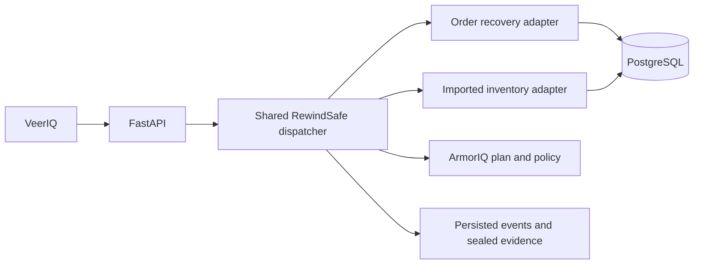

# VeerIQ architecture

VeerIQ presents recovery tasks through a React workspace. FastAPI coordinates sessions, grants, approval, and runs; PostgreSQL stores workflow and evidence state. RewindSafe provides the shared dispatcher and transaction boundaries. Workflow adapters supply domain-specific tools and constrained execution while the dispatcher applies the same identity, authorization, policy, event, and evidence path.

## Adapter interface

An adapter registers a stable workflow ID, an MCP namespace, its `ToolSpec` definitions, and available scenarios. The runtime obtains a scenario-specific grant from the adapter, then routes each planned call through the shared dispatcher. Adapters canonicalize arguments, check grant scope, validate domain preconditions, and execute the tool, returning structured observations and an optional repair manifest. The dispatcher owns proposal recording, ArmorIQ decisions, durable events, and run state; it does not duplicate workflow rules.

The second adapter, `rewindsafe.import_recovery`, uses the existing `rewindsafe-recovery` MCP namespace and five tool names. It was added without changing the dispatcher; [dispatch-baseline.sha256](dispatch-baseline.sha256) records the dispatcher's hash at that point. The dispatcher has since gained stricter argument validation (declared maximum lengths and item counts are enforced), so its current hash differs. Declarative mappings select primary key, tenant, flat scalar repair fields, their types, and authority-source columns. CSV/JSON uploads and bounded, verified-TLS, read-only PostgreSQL reads populate an isolated recovery workspace.

A grant binds tenant, selected records, approved snapshot ID/digest, fields, and commit limit. Trusted code derives values from that snapshot; a model cannot supply restoration values. Preparation and the locked transaction recheck tenant, row version, snapshot digest, and tombstone/revocation/hold/later-edit flags. The restricted role can update the `repair_values` JSON container and audit/version fields. Trusted catalog and grant checks restrict individual JSON keys; database privileges alone do not enforce per-key access. Identity, authority, and source metadata columns are outside the role’s update privileges.

Three incident packs—warehouse bins, medical assets, and subscription seats—are in [backend/samples/import_recovery](../backend/samples/import_recovery/). Recovery changes the workspace copy, not the imported source system. Nested structures and relational migrations are outside this adapter’s scope.

## Trust boundaries and evidence

For either workflow, RewindSafe rechecks the grant and domain rules before execution; the database transaction locks and revalidates current state and is the only write path. ArmorIQ plan binding and policy decisions remain distinct from RewindSafe’s local grant and approval controls. A second reviewer, when required, approves the exact manifest through the application flow.

Sealed run evidence is exported from persisted events and signed with a local Ed25519 key. A pinned public key verifies the payload and ordered event chain relative to that key. It does not establish an independent signer, sponsor attestation, or the truth of synthetic source data. See [evidence verification](offline-verification.md) and [current limitations](limitations.md).

New runs persist the exact end-of-run protected checks in `run.finished`, with observation time and RewindSafe source. The export signs these event details. Historical UI uses those records or nonempty commit-time receipt checks; current adapter state cannot certify an old run. Earlier imported runs lack detailed historical check records and are explicitly labelled accordingly.
