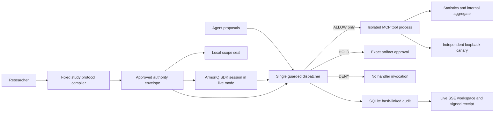

# VeerIQ

**Autonomous research. Authority bounded to the study.**

VeerIQ analyzes a synthetic cohort, retrieves methodological evidence, delegates statistics to a narrower worker, writes an internal report, and prepares an aggregate for human review. Every proposed tool call passes through one execution gate. The agent can attempt a forbidden export; the export handler remains untouched and an independent canary receives zero bytes.

Built for [ArmorIQ Flow State](https://armoriq.ai/hackathons/flow-state). The research concept is based on the supplied LabLine report; the project is branded VeerIQ.

## Run locally

Requires Node 24. No credentials needed for the local demonstration.

```sh
npm ci
npm run dev
```

Open http://127.0.0.1:5173. Choose **Run boundary demo**, inspect the denied export, review the computed aggregate, then approve it or keep it internal.

The local demo uses a **deterministic adversarial replay, actual MCP tools, a local protocol gate, and local evidence signing**. It does not claim to be a live ArmorIQ or live-model run.

For a single production build served locally:

```sh
npm run build
npm start
```

Open http://127.0.0.1:4310. The server intentionally binds to loopback.

## Verify

```sh
npm test
npm run benchmark
npm run verify-receipt -- /absolute/path/to/downloaded-receipt.json
```

The boundary tests use a loopback canary server and require local networking permission. Current verification: **14 tests passed**, **37/37 constructed boundary cases passed**, **0 forbidden tool executions**, **0 canary bytes**. [Benchmark artifact](docs/benchmark-results.json) records its exact scope and timestamp. These results are not a measurement of general prompt-injection resistance or live ArmorIQ performance.

## Live ArmorIQ integration

Copy `.env.example` to `.env` and configure these values privately:

```dotenv
ARMORIQ_MODE=live
ARMORIQ_API_KEY=your_platform_key
ARMORIQ_USER_EMAIL=your_authorized_identity
```

Restart. The official `@armoriq/sdk` creates a per-user `sdk` session, captures the plan, acquires a signed token, and checks calls before MCP dispatch. Missing keys or enforcement outages fail closed. The app does not fall back to its local gate in live mode.

Register the MCP/tool metadata and publication approval policy in your ArmorIQ project. The MCP identifier must be `labline-mcp` with the tool names in `server/scope.mjs`. SDK-mode enforcement leaves MCP transport on the application side; it does not remotely invoke the loopback tools. Confirm project requirements using current platform docs.

If ArmorIQ returns HOLD, the user must approve through ArmorIQ. VeerIQ’s button rechecks that decision; it cannot grant sponsor approval. The app also requires exact-artifact approval even if an ArmorIQ policy returns ALLOW. Decision evidence distinguishes these sources.

**Live status (October 12): credentials were imported privately from the user-authorized RewindSafe configuration. A live smoke check minted an ArmorIQ plan; the workspace rejected VeerIQ's in-plan research tool with `tool_not_in_allowlist`, and the undeclared identifiers tool was blocked by plan binding. VeerIQ-specific tool registration/policy remains required. The Groq key and configured model were verified through the model-list endpoint; inference, sponsor ALLOW, HOLD and approval have not been validated. Local enforcement remains selected. See [credential status](docs/credential-status.json).**

## Optional live model

Configure an OpenAI-compatible Chat Completions provider:

```dotenv
LLM_API_KEY=your_provider_key
LLM_MODEL=your_provider_model
LLM_BASE_URL=https://api.openai.com/v1
```

The workspace exposes a live-model selector once these are configured. The model chooses actual tool calls in a bounded 12-turn loop; the same dispatcher enforces them. Live reasoning may refuse the attack. That is useful evidence, but it is not evidence that the runtime blocked an attempted attack. Record both live behavior and the deterministic boundary replay separately. Live mode currently omits the separately delegated statistician workflow; replay demonstrates application-level scope narrowing.

## Architecture



The approved study is fixed to FLOW-42. Editing objective text never adds tools, changes the study, or expands authority. Statistics use 240 seeded synthetic participants, 2,000 bootstrap resamples and 2,000 two-sided permutations. Positive endpoint change means improvement. The aggregate contains no participant rows.

## Submission materials

- [VeerIQ versus RewindSafe: tested comparison and scores](docs/project-comparison.md)
- [Concept, competition strategy and website analysis](docs/strategy.md)
- [Architecture decisions and threat model](docs/architecture.md)
- [Three-minute demo script](docs/demo-script.md)
- [Live integration and final submission checklist](docs/submission.md)
- [Measured local boundary cases](docs/benchmark-results.json)
- [Completed replay receipt and observed effects](docs/evidence/README.md)
- [Visual design system](DESIGN.md)

No win, certification, universal security, or global novelty claim is made. The submission is strongest when the live ArmorIQ evidence and working research workflow are shown together.
