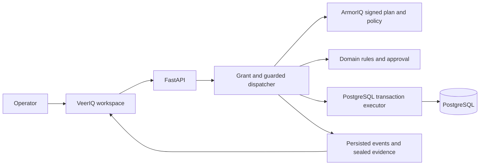

# Merged architecture

VeerIQ is the user-facing recovery workspace; RewindSafe is its durable execution engine. The React/Vite client presents incidents, grants, runs, approvals, and proof. A FastAPI service coordinates the workflow. PostgreSQL stores authority and incident state, and the repair executor owns the transaction that applies approved changes. An optional MCP server enters through the same dispatcher.

## Request to effect

1. The operator selects an incident scenario and reviews a task grant. The grant fixes the tenant, incident, allowed orders, repairable fields, tools, limits, and expiry.
2. The planner proposes tool calls. In live mode, the ArmorIQ SDK signs a plan for the task and checks proposed tools. An off-plan action can be refused by the local SDK’s plan-binding check; an in-plan action goes to ArmorIQ policy. In offline mode the local simulation is labeled as such.
3. RewindSafe independently checks the grant, canonical arguments, tenant, resources, current database state, and domain rules. A call requiring human review pauses for a separate reviewer. That review is bound to the exact repair manifest.
4. Before commit, the dispatcher repeats the relevant checks. The sole executor locks and revalidates current rows, checks the approved snapshot and authority constraints, and writes only eligible fields inside a PostgreSQL transaction. Idempotency prevents a duplicate commit.
5. Run events persist separately from business changes. The sealed evidence endpoint exports the run evidence, hashes the canonical payload and ordered event chain, and signs the envelope with a locally held Ed25519 key.

The controls have distinct owners. ArmorIQ binds the tool names in its signed plan; RewindSafe binds arguments and resources through its grant and domain checks; a second reviewer approves designated exact manifests; PostgreSQL constraints and privileges protect the final write. The successful live run’s `restore_access_grant` proposal was refused by the local SDK plan-binding check because that tool was absent from the signed plan. That observation does not establish that a configured sponsor policy blocked it.

The recorded review run `run_01M4R4X1K61W70GE` exercised the application approval boundary with live ArmorIQ and the scripted planner. The operator approval request returned HTTP 403; a separate demo reviewer approved the exact manifest; the run succeeded with two fields changed on O-2046 in one commit and all eight protected-state checks held. This was a RewindSafe application-level approval, not an ArmorIQ sponsor HOLD.

## Durable state and evidence

PostgreSQL is the source of truth for workflow state and committed repairs. This is the central architectural change from the legacy VeerIQ research prototype, whose MCP effects were process-local. Run evidence can be exported through `GET /api/runs/{run_id}/sealed-evidence`; the export reads stored records and events and does not invoke workflow handlers. See [the sealed evidence notes](../backend/docs/merged-evidence.md) for verifier behavior and key custody limits.

An embedded-key signature proves that the payload is consistent with that key. It does not prove the signer’s identity or that the evidence was never replaced and re-signed by an operator with the private key. Independent identity verification requires a public key obtained through a separate trusted channel. The receipt is not an ArmorIQ signature.

The two merged run exports and the bundled operator public key are under [`docs/evidence/merged/`](evidence/merged/). The bundled key pins the recorded operator signer for repeatable verification; it does not establish independent identity or certification.

## Scope and trust limits

The current product contains one order-repair workflow, one synthetic incident family, demo identities, and a disposable local database. Those identities support the demo’s separation-of-duties flow; they are not production login or multi-tenant identity. The database and policy boundaries are meaningful implementation controls, but the prototype has not been hardened or audited for deployment with customer data.

The seeded flagship scenario is “Poisoned runbook.” Its historical note asks the agent to restore a revoked account and affect another tenant. Live evidence records the revoked-access proposal blocked at plan binding. No prohibited handler entries or forbidden effects were recorded. Treat every identifier and record in the demo as synthetic. The live policy’s sponsor HOLD path has not been exercised because the required policy is unconfigured.

The old research workflow remains in `legacy/research/` with its own documentation; it is retained as project history and is not the active app.
